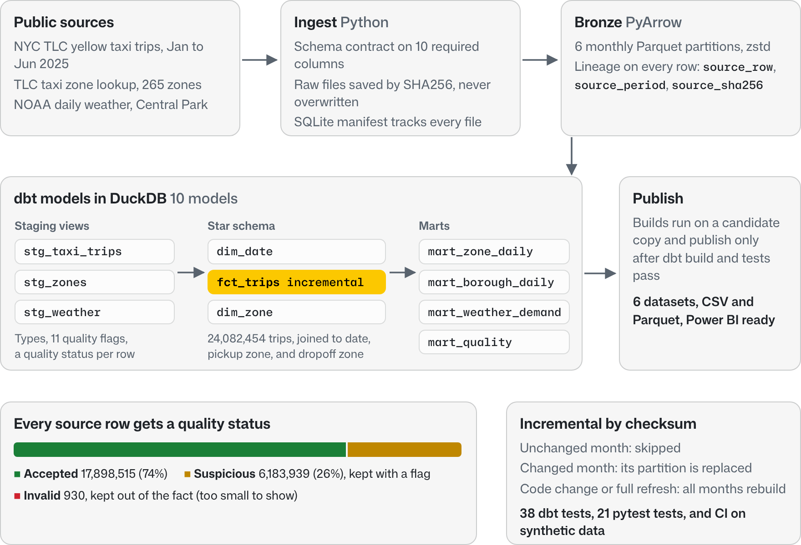

# MetroFlow

[](https://github.com/jeffreylin0217/metroflow/actions/workflows/ci.yml)

Incremental batch pipeline for real NYC taxi data. It loads monthly TLC trip files, official taxi zones, and NOAA daily weather into a tested star schema in DuckDB, and only reprocesses months that are new or changed.

<picture>
  <source media="(prefers-color-scheme: dark)" srcset="docs/assets/metroflow-architecture-dark.png">
  
</picture>

## At a glance

- 24.1M real yellow taxi trips (January to June 2025) in six monthly Parquet partitions
- 10 dbt models in DuckDB: 3 staging models, a trip fact, date and zone dimensions, and 4 marts
- 38 dbt tests and 21 pytest tests; GitHub Actions runs the whole pipeline on small synthetic data on every push
- Measured locally: rerun with no changes 0.3 s, one month backfill 18.7 s, full rebuild of all six months from local files 24.6 s
- 6 Power BI ready reporting datasets, each exported as CSV and Parquet

**Stack:** Python 3.12, PyArrow, Parquet, DuckDB, dbt, SQL, SQLite, pytest, GitHub Actions

## Architecture

Python handles downloads, checksums, schema checks, and exports. dbt handles everything inside the warehouse: staging, quality flags, the fact, dimensions, and marts.

## Design decisions

- **Checksums decide what runs.** Every source file's SHA256 hash is stored in a SQLite manifest. On a rerun, months whose bytes haven't changed are skipped, so a rerun with nothing new finishes in under a second.
- **Raw files are never overwritten.** Downloads are saved by hash, so a corrected upstream file becomes a new version instead of replacing the old one. Backfills rebuild from these local copies without downloading again.
- **Months are rebuilt as partitions.** A backfill deletes that month's rows from the fact and reloads them, so running the same month twice never duplicates trips. `scripts/verify_real.py` checks that a full refresh matches the incremental result.
- **Every row gets a quality status.** 930 unusable rows (missing or reversed timestamps, pickups outside the file's month, unrecognized zone IDs) stay out of the fact. About 6.2M suspicious rows, like negative fares that can be refunds or zero distance trips, stay in with a flag. `mart_quality` counts both.
- **Weather joins at the daily grain.** NOAA gives one observation per day, so it joins to daily demand instead of being copied onto 24M trip rows.
- **Nothing is published until the build passes.** dbt runs against a candidate copy of the warehouse, and the published tables and reports only change if the build and tests succeed.

## Data model

| Model | One row is | Rows |
|---|---|---:|
| fct_trips | one retained trip record | 24,082,454 |
| dim_zone | one official TLC zone | 265 |
| dim_date | one calendar date | 181 |
| mart_zone_daily | date × pickup zone | 43,732 |
| mart_borough_daily | date × pickup borough | 1,448 |
| mart_weather_demand | one weather observation date | 181 |
| mart_quality | source month × quality status | 18 |

`fct_trips` joins to `dim_date` on pickup date and to `dim_zone` for both pickup and dropoff. dbt tests check those relationships.


## Run it

Python 3.12 on macOS or Linux (WSL on Windows). The first run downloads public files, so no credentials are needed, but leave a few GB of disk free.

```bash
python3.12 -m venv .venv
source .venv/bin/activate
pip install -r requirements.lock

python -m metroflow.pipeline --start 2025-01 --end 2025-06
```

Other run modes:

```bash
# rerun with nothing new: verifies hashes and skips all work
python -m metroflow.pipeline --start 2025-01 --end 2025-06 --offline

# backfill one month from local raw files
python -m metroflow.pipeline --start 2025-03 --end 2025-03 --force-month 2025-03

# check the publishers for corrected files
python -m metroflow.pipeline --start 2025-01 --end 2025-06 --check-remote

# rebuild every loaded month from local raw files
python -m metroflow.pipeline --start 2025-01 --end 2025-06 --full-refresh --offline
```

## Tests

```bash
python -m pytest -q
```

pytest builds small synthetic source files and runs the real dbt build and tests on them, which is also what CI does. After a real run, you can test the full warehouse directly:

```bash
export METROFLOW_DB="$PWD/data/warehouse.duckdb"
dbt test --project-dir dbt --profiles-dir dbt
```

## More detail

[Architecture and failure recovery](docs/ARCHITECTURE.md) · [Quality rules](docs/QUALITY.md) · [Sources](docs/SOURCES.md) · [Measured results](docs/AUDIT.md) · [Power BI guide](docs/POWER_BI.md)

Scope: local batch processing. Scheduling is outside this repo, and the CLI can be called by any scheduler.
