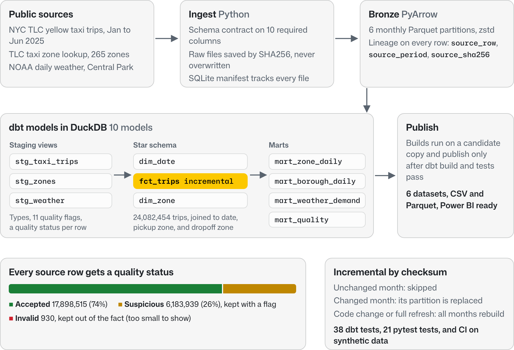

# MetroFlow

[](https://github.com/jeffreylin0217/metroflow/actions/workflows/ci.yml)

I built MetroFlow to learn how to keep the numbers right when a pipeline runs more than once. My first project, SleepLift, used my own sleep, caffeine, workout and food logs, which were small enough to check by eye. NYC taxi data is about 4 million trips a month, published as one file per month, and messy enough that "how many trips were there" takes some deciding.

It loads six months of TLC trip files, the official taxi zones, and NOAA daily weather into a star schema in DuckDB, and only reprocesses months that are new or changed. Later I put a SQL agent on top so I could ask the warehouse questions in plain English. A lot of that work went into the checks that stop it from running bad queries.

<picture>
  <source media="(prefers-color-scheme: dark)" srcset="docs/assets/metroflow-architecture-dark.png">
  
</picture>

- 24.1M trips from January to June 2025, 10 dbt models, 38 dbt tests, and 124 pytest tests across the pipeline, agent and review step, with CI on every push
- A rerun with nothing new takes 0.3 seconds, a one month backfill 18.7 seconds, and a full rebuild from local files 24.6 seconds
- The agent runs on a local model. Qwen got 11 of 15 test questions right, and Granite got 7 but was almost 7 times faster

**Stack:** Python, PyArrow, Parquet, DuckDB, dbt, SQLite, pytest, GitHub Actions. **Agent and review:** Ollama, sqlglot, MCP, LangGraph

## What the data shows

A few things stood out once the warehouse was built:

- 86% of the 24.1M trips I kept started in Manhattan. Newark Airport, which is in New Jersey, had more yellow taxi pickups (2,547) than all of Staten Island (2,316).
- May had about 32% more trips than January, 4.59M against 3.48M.
- In March, JFK was the third busiest pickup zone, behind Midtown Center and Upper East Side South.
- Rainy weekdays were busier, not slower. Weekdays with at least 10 mm of rain averaged about 11% more trips than dry weekdays (143K against 129K), though that's only 13 rainy days and I didn't control for month.

## How it works

Python downloads each month, checks its schema, and saves the raw file under its SHA256 hash, so a corrected upstream file becomes a new version instead of overwriting the old one. A SQLite manifest stores those hashes, and on a rerun any month whose bytes haven't changed is skipped.

dbt does everything inside the warehouse. A changed month is deleted from the fact table and reloaded, so running the same month twice never duplicates trips, and `scripts/verify_real.py` checks that a full refresh gives the same result as the incremental runs.

Every row gets a quality status. Only 930 rows are unusable (missing or reversed timestamps, pickups outside the file's month, unknown zones) and stay out of the fact. About 6.2M are odd but plausible, like negative fares that can be refunds, so they stay in with a flag instead of being thrown away. A dbt test checks that the status counts add up to the number of Bronze rows, and that every mart adds up to the same number of trips as the fact table. Weather joins after trips are rolled up to days, since NOAA has one reading per day.

The build runs against a candidate copy of the warehouse, and the published tables only change if the build and tests pass.

| Model | One row is | Rows |
|---|---|---:|
| fct_trips | one retained trip record | 24,082,454 |
| dim_zone | one official TLC zone | 265 |
| dim_date | one calendar date | 181 |
| mart_zone_daily | date × pickup zone | 43,732 |
| mart_borough_daily | date × pickup borough | 1,448 |
| mart_weather_demand | one weather observation date | 181 |
| mart_quality | source month × quality status | 18 |

`fct_trips` joins to `dim_date` on pickup date and to `dim_zone` for both pickup and dropoff. dbt tests check those relationships.

## Asking it questions

I wanted to see if a small model on my laptop could answer real questions about this warehouse without being able to break anything. It writes SQL against the Gold tables, my code checks every query before DuckDB runs it read only, and I measured accuracy on a fixed set of questions across three models. Other AI tools can use the same checked queries through MCP. More in [docs/AGENT.md](docs/AGENT.md).

A real run on my laptop:

```text
$ python -m metroflow.agent "Which 5 pickup zones had the most retained trips in March 2025?" --show-sql
The top 5 pickup zones with the most retained trips in March 2025 were:

1. **Midtown Center** - 182,169 trips
2. **Upper East Side South** - 170,960 trips
3. **JFK Airport** - 161,905 trips
4. **Upper East Side North** - 153,017 trips
5. **Times Sq/Theatre District** - 136,855 trips

These figures represent retained trips (including both ACCEPTED and SUSPICIOUS records) from the mart_zone_daily table for March 2025. The data is recorded in USD for fares and miles for distance, with duration measured in minutes.

SQL: SELECT d.zone, SUM(m.trip_count) AS total_trips FROM main.mart_zone_daily AS m JOIN main.dim_zone AS d ON m.zone_key = d.zone_key WHERE m.date >= '2025-03-01' AND m.date <= '2025-03-31' GROUP BY d.zone ORDER BY total_trips DESC LIMIT 5
Attempts: 2
```

It needed a second attempt. The final query sums `trip_count` instead of counting rows, which matters because each row in that table is a day and zone, not a trip. The last sentence about units wasn't asked for; it picked that up from my table notes. I checked the five totals against a direct query and they match.

A query can be right and the written answer can still get a number wrong, so I also built a separate LangGraph workflow for questions about daily trip totals. It checks the answer's numbers in code, asks the model to review it in a separate call, retries once, and pauses for my approval if it's still unsure. More in [docs/REVIEW.md](docs/REVIEW.md).

## What I ran into

- My table check could be tricked. An early version accepted `WITH stg_zones AS (SELECT * FROM stg_zones) SELECT * FROM stg_zones`. The checker treated every `stg_zones` as the CTE, but inside its own definition DuckDB reads the real staging table. Now a CTE name only counts after it's defined, and that query is a test.
- The model eval found a bug in my checker, not the model. sqlglot treats `AND` and `OR` as functions, and they weren't on my allowed list, so normal `WHERE` clauses were getting blocked.
- Small models like to count rows. On a daily table, `COUNT(*)` counts days or zones, not trips, which is why my table notes tell the model to use `SUM(trip_count)`.
- Example queries in the prompt didn't help overall. Held out questions went from 7 to 9 out of 10, but the original set dropped from 10 to 8 out of 15, so I took them out.

## Limits

- It runs locally, and scheduling is outside this repo.
- CI uses small synthetic data and a fake model. The real six months are checked with `scripts/verify_real.py` on my machine.
- The agent eval is small, 25 questions, and Qwen got 17 on a separate baseline run.
- The review workflow only handles daily trip totals.
- There's no Power BI file here, only the exported datasets and a guide.

## Run it

Python 3.12 on macOS or Linux (WSL on Windows). The first run downloads public files, so no credentials are needed, but leave a few GB of disk free.

```bash
python3.12 -m venv .venv
source .venv/bin/activate
pip install -r requirements.lock

python -m metroflow.pipeline --start 2025-01 --end 2025-06
```

Other run modes:

```bash
# rerun with nothing new: checks hashes and skips all work
python -m metroflow.pipeline --start 2025-01 --end 2025-06 --offline

# backfill one month from local raw files
python -m metroflow.pipeline --start 2025-03 --end 2025-03 --force-month 2025-03

# check the publishers for corrected files
python -m metroflow.pipeline --start 2025-01 --end 2025-06 --check-remote

# rebuild every loaded month from local raw files
python -m metroflow.pipeline --start 2025-01 --end 2025-06 --full-refresh --offline
```

## Tests

```bash
python -m pytest -q
```

pytest builds small synthetic source files and runs the real dbt build and tests on them, which is also what CI does. After a real run, you can test the full warehouse directly:

```bash
export METROFLOW_DB="$PWD/data/warehouse.duckdb"
dbt test --project-dir dbt --profiles-dir dbt
```

## More detail

[Architecture and failure recovery](docs/ARCHITECTURE.md) · [SQL agent](docs/AGENT.md) · [Review step](docs/REVIEW.md) · [Quality rules](docs/QUALITY.md) · [Sources](docs/SOURCES.md) · [Measured results](docs/AUDIT.md) · [Power BI guide](docs/POWER_BI.md)
